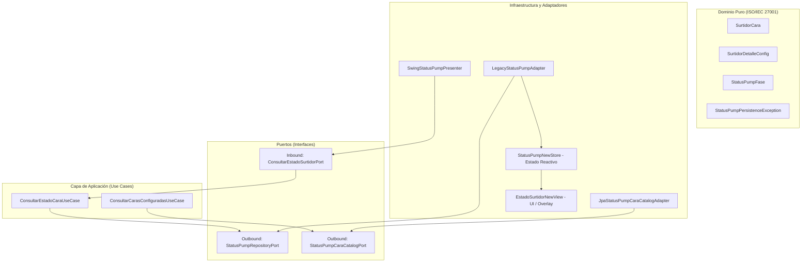
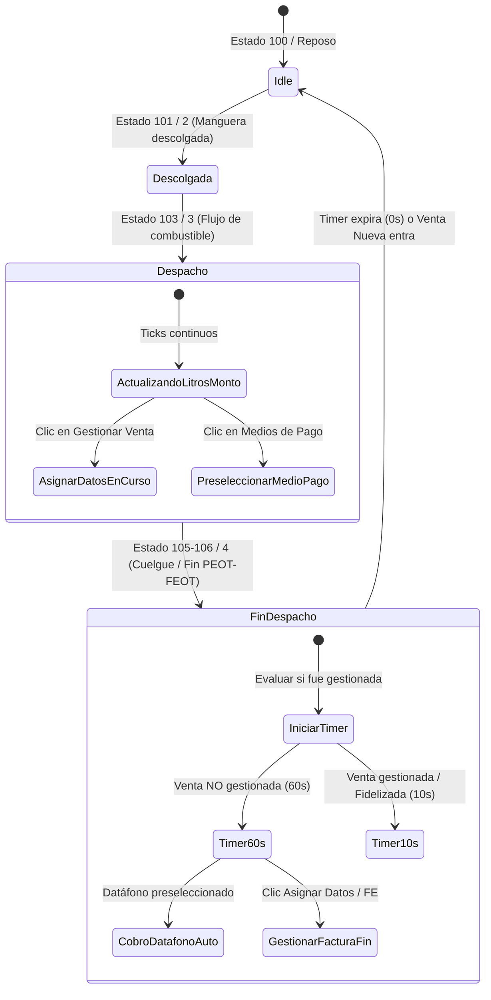

# Análisis Completo: Status Pump NEW (Java LazoExpress EE) y su Adaptación a Flutter con Arquitectura Hexagonal y SurtidorAPI

---

## 1. Resumen Ejecutivo

El módulo **Status Pump NEW** de la aplicación Java (`ap31tpt-terpelpos-transicion-lazo-express-ee`) representa la evolución del monitoreo y gestión de surtidores de Terpel. Sustituye la vista monolítica tradicional por una arquitectura desacoplada y reactiva que gestiona el ciclo de vida completo de cada cara de la estación de servicio: desde la detección de manguera descolgada, despacho en tiempo real con actualización de litros y montos, hasta el período de gracia post-despacho (**Fin de Despacho**) con temporizador inteligente para la gestión de facturación, fidelización y medios de pago.

En el nuevo entorno móvil/touch desarrollado en **Flutter (`POS_FLUTTER2.0_A`)**:
- **Se descarta LazoWatch** (módulo socket legacy TCP de Java).
- **Se utiliza SurtidorAPI** (backend moderno Flask + Socket.IO en puerto 5000), el cual recibe los eventos directamente de `CoreGilbarco` (`POST /api/estado-surtidor`) y los difunde en tiempo real mediante el evento WebSocket `estado_surtidor`.
- **Se implementa bajo Arquitectura Hexagonal (Ports & Adapters)** pura en Dart, garantizando el aislamiento del dominio frente a Socket.IO y la capa de presentación Flutter.

---

## 2. Deconstrucción del Proyecto Java (`lazo-express-ee`)

El proyecto original cuenta con dos estructuras complementarias:
1. **El paquete hexagonal puro**: `com.firefuel.statuspump.hexagonal`
2. **El gestor de estado y componentes de presentación**: `com.firefuel.statuspump`



### 2.1 Capa de Dominio (`hexagonal/domain`)

* **`SurtidorCara`**: Entidad inmutable de dominio que modela el estado de una cara sin dependencias de librerías gráficas ni base de datos:
  * `cara` (int), `manguera` (int).
  * `fase`: Enum `StatusPumpFase` (`DESPACHO`, `FIN_DESPACHO`).
  * Flags booleanos: `enVenta1`, `enVenta2`, `gestionaVenta`, `ventaAFidelizar`, `isRumbo`.
  * Metadatos: `placa`, `clienteNombre`.
  * Regla de negocio: `esVentaEspecial() => ventaAFidelizar || isRumbo || enVenta1`.
* **`SurtidorDetalleConfig`**: Configuración física de las mangueras activas (`cara`, `manguera`, `familiaDescripcion`).
* **`StatusPumpFase`**:
  * `DESPACHO`: Surtidor entregando combustible activamente.
  * `FIN_DESPACHO`: Venta terminada físicamente; ventana de oportunidad para asignar datos o medios de pago.

### 2.2 Capa de Aplicación (`hexagonal/application`)

* **`ConsultarEstadoCaraUseCase`**:
  * Implementa `ConsultarEstadoSurtidorPort`.
  * Consulta el estado de una cara específica a través del repositorio.
  * Calcula los segundos restantes de fin de despacho:
    $$\text{segundosRestantes} = \left\lceil \frac{\text{deadlineMs} - \text{currentTimeMs}}{1000} \right\rceil$$
  * Valida si una venta ya fue gestionada en BD (`esVentaYaGestionada(idMovimiento)`).
* **`ConsultarCarasConfiguradasUseCase`**: Lista el catálogo activo de mangueras y familias sin limitarse a un número fijo de caras.

### 2.3 Capa de Infraestructura y Estado (`statuspump`)

* **`StatusPumpNewStore`** (El corazón reactivo):
  * Mantiene una colección en memoria: `TreeMap<Integer, StatusPumpVentaEntry> ENTRIES`.
  * Almacena: `panel`, `fase`, `deadlineFinMs`, `idMovimiento`.
  * Gestiona el foco (`caraFoco`) y el timer global de expiración (`expiryTimer`).
  * Implementa filtros anti-ruido (ignora ticks tardíos o paquetes fuera de orden de otras mangueras).
* **`CaraUiSlot`**:
  * Componente que representa cada botón/chip de cara en la barra superior.
  * Soporta caras dinámicas (1 a 32+).
  * Cambia de apariencia (color de la familia del combustible, animación de despacho, badge verde en fin de despacho).
* **`StatusPumpProductColors`**:
  * Paleta corporativa Terpel:
    * **Corriente**: `#EC000F` (Rojo)
    * **Extra**: `#0070D5` (Azul)
    * **Diesel / ACPM**: `#FDB913` (Amarillo)
    * **GLP / Gas**: `#0FAB0B` (Verde)
    * **Fin Despacho**: Fondo `#DCF5DC`, texto/borde `#0B8A08`
    * **Inactivo / Idle**: `#42535C`
  * Constantes de expiración:
    * `TIEMPO_EXPIRACION_NO_GESTIONADA_MS`: **60 segundos** (por defecto).
    * `TIEMPO_EXPIRACION_GESTIONADA_MS`: **10 segundos** (configurable).

---

## 3. Máquina de Estados y Ciclo de Vida de la Venta

El ciclo de vida en `StatusPump NEW` es significativamente más rico que una simple lectura de socket:



### Reglas críticas observadas en el código:

1. **Persistencia temporal en `FIN_DESPACHO` (No borrar la cara de inmediato)**:
   * **Error común en implementaciones previas**: Cuando el surtidor termina (estado 105/106), la cara se eliminaba inmediatamente del mapa.
   * **Comportamiento correcto en StatusPump NEW**: La cara permanece visible con un badge verde de `FIN_DESPACHO` y un contador regresivo. El operario tiene hasta 60 segundos para asociar cliente, cédula o medio de pago antes de que se archive como venta no gestionada.
2. **Tiempo reducido para ventas ya gestionadas (10s)**:
   * Si durante el despacho el operario ya ingresó los datos del cliente (o fue autorizada por Rumbo/Gopass/App Terpel), al terminar el despacho no se requieren 60 segundos; el timer se ajusta a 10 segundos y se cierra automáticamente.
3. **Filtro de Ruido (Anti-Race Condition)**:
   * Si una cara está en `DESPACHO` con la manguera 1 (Corriente) y entra un paquete residual de manguera 2 con volumen 0, se descarta.
   * Si una cara está en `FIN_DESPACHO` y llega un tick tardío de estado 3 con el mismo volumen/monto, se ignora para no reiniciar el temporizador de cierre.

---

## 4. Comparativa: LazoWatch (Legacy) vs SurtidorAPI (Flask + Socket.IO)

| Característica | LazoWatch Legacy (Java) | SurtidorAPI (Arquitectura Actual) |
| :--- | :--- | :--- |
| **Tecnología** | Sockets TCP / WS nativos en Java (puerto 8000/10000) | Flask + Flask-SocketIO (puerto 5000) |
| **Origen de los datos** | Lectura directa o puente complejo con DLLs | `CoreGilbarco.jar` vía HTTP REST `POST /api/estado-surtidor` |
| **Evento WebSocket** | Tráfico de bytes / frames binarios de Java | Evento JSON estandarizado: `'estado_surtidor'` |
| **Consumidores** | Solo aplicación desktop Swing | Aplicación Flutter (Móvil y Tablet), POS Web, etc. |
| **Tolerancia a fallos** | Caídas de conexión bloqueaban la UI | Reconexión automática con polling/websocket en background |

### Formato del Payload de `SurtidorAPI`:
```json
{
  "surtidor_id": 1,
  "cara": 1,
  "estado": 3,
  "estado_publico": 103,
  "descripcion": "fueling",
  "monto": 45000,
  "volumen": 3.456,
  "precioUnidad": 15200,
  "producto": "CORRIENTE"
}
```

---

## 5. Diseño de la Arquitectura Hexagonal en Flutter

Para replicar con total fidelidad el comportamiento de `StatusPump NEW` manteniendo la limpieza y mantenibilidad del proyecto Flutter (`POS_FLUTTER2.0_A`), proponemos la siguiente estructura en `lib/features/status_pump`:

```
lib/features/status_pump/
│
├── domain/                                 # CAPA DE DOMINIO (Pura, sin Flutter/Dart IO)
│   ├── entities/
│   │   ├── surtidor_cara_entity.dart       # Entidad principal (cara, manguera, fase, etc.)
│   │   ├── status_pump_fase.dart           # Enum (despacho, finDespacho, idle)
│   │   ├── surtidor_detalle_config.dart    # Configuración de producto y manguera
│   │   └── combustible_color.dart          # Mapeo de paleta de colores por familia
│   │
│   ├── ports/
│   │   ├── in/
│   │   │   └── consultar_estado_surtidor_port.dart   # Puerto de entrada para la UI
│   │   └── out/
│   │       ├── surtidor_socket_stream_port.dart      # Puerto de salida para Socket.IO
│   │       └── status_pump_cache_port.dart           # Puerto de salida para persistencia temporal
│   │
│   └── exceptions/
│       └── status_pump_exception.dart
│
├── application/                            # CAPA DE APLICACIÓN (Casos de Uso)
│   └── usecases/
│       ├── procesar_evento_surtidor_usecase.dart     # Máquina de estados, anti-ruido, timer
│       ├── calcular_tiempo_restante_usecase.dart     # Cálculo de segundos para badge fin
│       └── clasificar_venta_usecase.dart             # Lógica Rumbo / Cliente Propio / Fidelización
│
├── infrastructure/                         # CAPA DE INFRAESTRUCTURA (Adaptadores externos)
│   ├── datasources/
│   │   └── surtidor_socket_io_datasource.dart        # Conexión con Flask:5000 'estado_surtidor'
│   └── adapters/
│       └── surtidor_stream_adapter.dart              # Implementa SurtidorSocketStreamPort
│
└── presentation/                           # CAPA DE PRESENTACIÓN (Flutter UI)
    ├── providers/
    │   └── status_pump_provider.dart                 # State Management reactivo (ChangeNotifier)
    ├── widgets/
    │   ├── cara_selector_bar.dart                    # Barra superior de selección con chips de colores
    │   ├── cara_slot_chip.dart                       # Chip individual (número, raya de producto, badge fin)
    │   ├── surtidor_active_card.dart                 # Card principal con monto, galones, precio y producto
    │   ├── countdown_timer_badge.dart                # Badge verde animado con cuenta regresiva (60s/10s)
    │   └── status_pump_actions_bar.dart              # Botones "Gestionar Venta" y "Medios de Pago"
    └── pages/
        └── status_pump_page.dart                     # Pantalla completa o contenedor embebido
```

---

## 6. Especificación de Componentes Clave en Flutter

### 6.1 Entidad de Dominio (`surtidor_cara_entity.dart`)

```dart
enum StatusPumpFase { despacho, finDespacho, idle }

class SurtidorCaraEntity {
  final int cara;
  final int manguera;
  final StatusPumpFase fase;
  final String producto;
  final String familia;
  final double monto;
  final double volumen;
  final double precioUnidad;
  final bool gestionaVenta;
  final bool ventaAFidelizar;
  final bool isRumbo;
  final bool isClientePropio;
  final String placa;
  final String clienteNombre;
  final DateTime? deadlineFin;

  const SurtidorCaraEntity({
    required this.cara,
    this.manguera = 1,
    this.fase = StatusPumpFase.idle,
    this.producto = '',
    this.familia = '',
    this.monto = 0.0,
    this.volumen = 0.0,
    this.precioUnidad = 0.0,
    this.gestionaVenta = false,
    this.ventaAFidelizar = false,
    this.isRumbo = false,
    this.isClientePropio = false,
    this.placa = '',
    this.clienteNombre = '',
    this.deadlineFin,
  });

  int get segundosRestantes {
    if (deadlineFin == null) return 0;
    final restantes = deadlineFin!.difference(DateTime.now()).inSeconds;
    return restantes > 0 ? restantes : 0;
  }

  bool get esVentaEspecial => ventaAFidelizar || isRumbo || isClientePropio;
  bool get permiteMediosPago => !esVentaEspecial;
}
```

### 6.2 Paleta Corporativa Terpel (`combustible_color.dart`)

```dart
import 'package:flutter/material.dart';

class TerpelFuelColors {
  static const Color corriente = Color(0xFFEC000F); // Rojo
  static const Color extra = Color(0xFF0070D5);     // Azul
  static const Color diesel = Color(0xFFFDB913);    // Amarillo
  static const Color glp = Color(0xFF0FAB0B);       // Verde
  static const Color gas = Color(0xFF0FAB0B);       // Verde
  static const Color idle = Color(0xFF42535C);      // Gris azulado
  static const Color finBg = Color(0xFFDCF5DC);     // Verde claro fondo
  static const Color finFg = Color(0xFF0B8A08);     // Verde oscuro texto/borde

  static Color fromFamilia(String familia) {
    final f = familia.toLowerCase();
    if (f.contains('extra')) return extra;
    if (f.contains('diesel') || f.contains('acpm')) return diesel;
    if (f.contains('glp') || f.contains('gas')) return glp;
    return corriente;
  }
}
```

### 6.3 Ajuste Crítico en `StatusPumpProvider` (Lógica de Expiración)

Actualmente en `status_pump_provider.dart`, cuando llega un estado de fin (105 o 106) se ejecutaba `_surtidores.remove(estado.cara)`. **El cambio fundamental es transformarlo a `StatusPumpFase.finDespacho`**:

```dart
// En lugar de remover inmediatamente:
void _onFinDespacho(int cara, double montoFinal, double volumenFinal) {
  final existente = _surtidores[cara];
  final gestionada = existente?.gestionaVenta ?? false;
  final tiempoMs = gestionada ? 10000 : 60000;
  final deadline = DateTime.now().add(Duration(milliseconds: tiempoMs));

  _surtidores[cara] = (existente ?? SurtidorCaraEntity(cara: cara)).copyWith(
    fase: StatusPumpFase.finDespacho,
    monto: montoFinal,
    volumen: volumenFinal,
    deadlineFin: deadline,
  );

  // Iniciar timer local de refresco de segundos y auto-eliminación al expirar
  _iniciarTimerExpiracion(cara, deadline);
  notifyListeners();
}
```

---

## 7. Plan de Acción para la Implementación en Flutter

1. **Paso 1: Refactor de Entidades y Estados**
   * Crear la entidad pura `SurtidorCaraEntity` con el enum `StatusPumpFase` y las reglas de negocio (`esVentaEspecial`, `permiteMediosPago`).
2. **Paso 2: Implementación de la Temporización Inteligente en `StatusPumpProvider`**
   * Sustituir el borrado inmediato en estados `105/106` por la transición a `StatusPumpFase.finDespacho`.
   * Programar el temporizador periódico (1 segundo) para refrescar los `segundosRestantes` en la UI y archivar automáticamente la cara al llegar a `0s`.
3. **Paso 3: Construcción de la Barra de Caras Touch (`cara_selector_bar.dart`)**
   * Renderizar las caras activas con su franja de color correspondiente a la familia de producto.
   * Mostrar el badge verde pulsante en aquellas caras que estén en `FIN_DESPACHO`.
4. **Paso 4: Card de Despacho en Vivo (`surtidor_active_card.dart`)**
   * Tipografía grande y clara para Monto y Volumen.
   * Contador regresivo visible (ej. `Finalizado - 54s`).
   * Botones de acción: **"Gestionar Venta"** (abre formulario de cliente/FE) y **"Medios de Pago"** (abre bottom sheet o cobro datáfono).
5. **Paso 5: Validación Cruzada con `CoreGilbarco` y `SurtidorAPI`**
   * Probar el flujo completo: Inicio de despacho en surtidor -> CoreGilbarco -> Flask -> Socket.IO -> Flutter -> Fin de despacho con cuenta regresiva.
